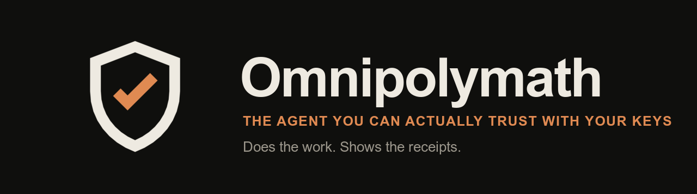

# Omnipolymath

**The AI agent you can actually trust with your keys.**

<p align="center">
  <picture>
    <source media="(prefers-color-scheme: light)" srcset="docs/assets/omnipolymath-banner-light.png">
    
  </picture>
</p>

<p align="center">
  <a href="https://github.com/krishnashahane/Omnipolymath/actions/workflows/omnipolymath-ci.yml"></a>
  <a href="https://github.com/krishnashahane/Omnipolymath/releases/latest"></a>
  <a href="LICENSE"></a>
  <a href="https://omnipolymath.vercel.app/docs"></a>
</p>

Omnipolymath is an open-source AI assistant that runs on your own computer and works from the chat apps you already use: WhatsApp, Telegram, Slack, Discord, Signal, iMessage, Teams and more, plus a browser Control UI. It clears your inbox, does research, runs scheduled errands and ships code.

A **Trust Firewall** sits between the agent and everything it touches. It asks before anything that spends money or can't be undone, notices when a web page or email tries to take over, and ends every run with a receipt.

[Website](https://omnipolymath.vercel.app) · [Docs](https://omnipolymath.vercel.app/docs) · [Getting started](https://omnipolymath.vercel.app/docs/start/getting-started) · [Trust Firewall](extensions/trust-firewall/README.md) · [Releases](https://github.com/krishnashahane/Omnipolymath/releases) · [FAQ](https://omnipolymath.vercel.app/docs/help/faq)

## Install

macOS, Linux and Windows (WSL2) with Node.js 24.16+ or 26.1+:

```bash
curl -fsSL https://omnipolymath.vercel.app/install.sh | bash
```

The installer downloads the prebuilt package from the [latest release](https://github.com/krishnashahane/Omnipolymath/releases/latest), checks its SHA-256, installs it into `~/.omnipolymath-cli` and starts onboarding. It never runs as root. Add `--from-source` to build from this repository instead (needs git and pnpm).

Then check that everything is running:

```bash
omnipolymath gateway status
omnipolymath dashboard
```

The dashboard opens the Control UI; send a message there to confirm the assistant works. The [getting started guide](https://omnipolymath.vercel.app/docs/start/getting-started) covers connecting chat apps.

## The Trust Firewall

On by default. Highlights:

**Stays in control**

- **Approvals:** anything that spends money or can't be taken back waits for you. Each agent gets only the tools you allow.
- **Posture presets:** `posture: "restricted"` asks before anything leaves the machine; `"balanced"` is the default.
- **Host guard:** without a sandbox, shell commands that change your machine (sudo, system files, global installs, services, SSH keys) need approval.

**Resists hijacking**

- **Injection shield:** every tool result is pattern-scanned, and web, email and chat content that addresses an AI gets a second opinion from your own model. A run that reads a hijack attempt loses the right to send, pay or delete on its own.
- **Egress guard:** agent shells can't reach cloud-metadata endpoints that hand out credentials; optionally, each new host needs your approval once.
- **Safe plugin installs:** installs of unpublished or impersonated package names are blocked.

**Shows its work**

- **Receipts:** every run ends with what it did, what it cost, what changed and what was stopped.
- **Tamper-evident log:** every decision is a hash-chained line; `omnipolymath firewall verify` points at any edit.
- **Undo for files:** `write`, `edit` and `apply_patch` are snapshotted, and `omnipolymath firewall undo <run>` restores them.

**Keeps costs down**

- **Spend cap:** a hard daily cap priced from what your provider reports, kept across restarts.
- **Agent wallets:** payment tools are held to per-transaction and daily limits and an optional payee allowlist.

> **What undo can't reverse:** shell commands that already ran, messages that were sent and payments that went through stay done. That's why the risky ones wait for your approval.

Configuration lives in `~/.omnipolymath/omnipolymath.json`. The full reference, with every setting, is in [extensions/trust-firewall/README.md](extensions/trust-firewall/README.md).

## How it fits together

- The [Gateway](https://omnipolymath.vercel.app/docs/gateway) is the local control plane for sessions, tools and channel connections.
- The [Control UI](https://omnipolymath.vercel.app/docs/web/control-ui), CLI and [TUI](https://omnipolymath.vercel.app/docs/web/tui) connect to the Gateway.
- [Channels](https://omnipolymath.vercel.app/docs/channels) bring the assistant to your chat apps.
- [Model providers](https://omnipolymath.vercel.app/docs/concepts/model-providers) cover hosted and local models; [tools](https://omnipolymath.vercel.app/docs/tools), [skills](https://omnipolymath.vercel.app/docs/tools/skills) and [plugins](https://omnipolymath.vercel.app/docs/plugins) extend what it can do.

## Documentation

| Goal                          | Start here                                                                                                                                                                  |
| ----------------------------- | --------------------------------------------------------------------------------------------------------------------------------------------------------------------------- |
| Configure models and auth     | [Models](https://omnipolymath.vercel.app/docs/concepts/models) · [Model providers](https://omnipolymath.vercel.app/docs/concepts/model-providers)                           |
| Connect a chat app            | [Channels](https://omnipolymath.vercel.app/docs/channels)                                                                                                                   |
| Add tools, skills and plugins | [Tools](https://omnipolymath.vercel.app/docs/tools) · [Skills](https://omnipolymath.vercel.app/docs/tools/skills) · [Plugins](https://omnipolymath.vercel.app/docs/plugins) |
| Use the CLI                   | [CLI reference](https://omnipolymath.vercel.app/docs/cli) · [Slash commands](https://omnipolymath.vercel.app/docs/tools/slash-commands)                                     |
| Run it in Docker or the cloud | [Docker](https://omnipolymath.vercel.app/docs/install/docker) · [VPS hosting](https://omnipolymath.vercel.app/docs/vps)                                                     |
| Operate the Gateway           | [Configuration](https://omnipolymath.vercel.app/docs/gateway/configuration) · [Updating](https://omnipolymath.vercel.app/docs/install/updating)                             |

## Repository layout

This is a pnpm monorepo. The main folders:

| Path                               | What's inside                                                            |
| ---------------------------------- | ------------------------------------------------------------------------ |
| `src/`                             | The Gateway, CLI, agents and core runtime                                |
| `extensions/`                      | Bundled plugins: channels, model providers, tools and the Trust Firewall |
| `packages/`                        | Shared libraries, including the Gateway protocol and client              |
| `ui/`                              | The browser Control UI                                                   |
| `apps/`                            | Source for the macOS, iOS, Android and Linux apps                        |
| `site/`                            | The website and docs site at omnipolymath.vercel.app                     |
| `docs/`                            | Documentation sources                                                    |
| `skills/`, `custodian-skills/`     | Bundled agent skills                                                     |
| `crates/`                          | Rust components (Gateway client and peer-to-peer node)                   |
| `scripts/`, `test/`, `qa/`         | Build and release scripts, tests and QA scenarios                        |
| `config/`, `security/`, `patches/` | Lint and test baselines, security scanning rules, dependency patches     |
| `deploy/`                          | Extra deployment configs (private Fly.io)                                |

The files at the top level are load-bearing, so they stay where they are:

- **CLI entry point:** `omnipolymath.mjs`.
- **Startup modules it loads by relative path:** `cli-*.mjs`, `gateway-*.mjs`, `node-*.mjs` and `runtime-process-*.mjs`. Each has a matching `.d.mts` type file.
- **Workspace and build config:** `package.json`, `pnpm-*.yaml`, `tsconfig*.json`, `tsdown*.config.ts` and `vitest.config.ts`.
- **Deploy configs:** `Dockerfile`, `docker-compose.yml`, `fly.toml` and `render.yaml` sit where Docker, Fly.io and Render look for them.

## Security

Treat inbound messages as untrusted input. Chat channels pair unknown senders by default; approve one with `omnipolymath pairing approve <channel> <code>`. Before exposing the Gateway, read the [security guide](https://omnipolymath.vercel.app/docs/gateway/security) and the [sandboxing guide](https://omnipolymath.vercel.app/docs/gateway/sandboxing).

Report vulnerabilities privately through a [GitHub Security Advisory](https://github.com/krishnashahane/Omnipolymath/security/advisories/new); see [SECURITY.md](SECURITY.md).

## Development

```bash
git clone https://github.com/krishnashahane/Omnipolymath.git
cd Omnipolymath
pnpm install
pnpm build
pnpm ui:build
```

Plain `npm install` at the repository root isn't supported. See [CONTRIBUTING.md](CONTRIBUTING.md) for the workflow and the [source setup guide](https://omnipolymath.vercel.app/docs/start/setup) for the development loop.

## Maintainer

Built and maintained by **Krishna Shahane**: [GitHub](https://github.com/krishnashahane) · [LinkedIn](https://www.linkedin.com/in/krishna-shahane-721522273/) · [X](https://x.com/krishnashahane_) · [Instagram](https://www.instagram.com/urstrulylkrishna/)

Bugs and feature requests go through the [issue chooser](https://github.com/krishnashahane/Omnipolymath/issues/new/choose).

## License

MIT. See [LICENSE](LICENSE) for copyright notices and [THIRD_PARTY_NOTICES.md](THIRD_PARTY_NOTICES.md) for third-party components.
